[](LICENSE)
[](https://github.com/StaffOps/kube-node-viewer/actions/workflows/test.yaml)
[](https://scorecard.dev/viewer/?uri=github.com/StaffOps/kube-node-viewer)

# kube-node-viewer

`kube-node-viewer` is a terminal UI for watching node usage and cost in a
Kubernetes cluster. For every node it shows the resources requested by the
pods scheduled on it against the node's allocatable capacity, the pod count
and the node price, and it sums them per group and for the whole cluster.

It reads **requests**, not actual usage: it answers "how full are my nodes
from the scheduler's point of view, and what do they cost", which is what
drives node count and the bill. It needs nothing installed in the cluster,
only read access through your kubeconfig.

Start it with no flags and drive it from inside: filter, group and sort the
nodes, pick columns and resources, search, fold groups and switch cluster
without restarting. A second screen, Recommendations, says what to do about
the cost: consolidate, rightsize, move to a newer generation or Graviton,
recycle old nodes and, last, Spot. The last view used on each cluster comes
back the next time, or, if you prefer, a view written in `config.yaml`
(see [Config views](#config-views)).

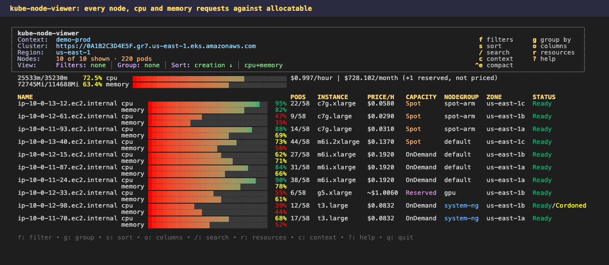

The screenshots and the animation use a made-up cluster; they are regenerated
with `scripts/screenshots.sh`.

## Contents

- [Installation](#installation)
- [Quick start](#quick-start)
- [What is on screen](#what-is-on-screen)
- [Keys](#keys)
- [Panels](#panels)
- [Recommendations](#recommendations)
- [Saved view per cluster](#saved-view-per-cluster)
- [Flags and config file](#flags-and-config-file)
- [Label visibility](#label-visibility)
- [Config views](#config-views)
- [Pricing](#pricing)
- [Computed labels](#computed-labels)
- [Troubleshooting](#troubleshooting)
- [How it works](#how-it-works)
- [Development](#development)

## Installation

With [Homebrew](https://brew.sh) (macOS and Linux):

```shell
brew install staffops/tap/kube-node-viewer
```

Or download an archive from the
[releases](https://github.com/StaffOps/kube-node-viewer/releases) page, or
install with Go:

```shell
go install github.com/staffops/kube-node-viewer/cmd/kube-node-viewer@latest
```

This installs to your `GOBIN` directory, typically `~/go/bin`.

### Verifying a release

Each release's checksum file is signed with [Sigstore](https://www.sigstore.dev)
by the release workflow (no long-lived key), and each archive has an SPDX
SBOM (`<archive>.sbom.json`) listed in that file. With
[cosign](https://docs.sigstore.dev/cosign/system_config/installation/) 3 or
later, for version `X.Y.Z`:

```shell
f=kube-node-viewer_X.Y.Z_sha256_checksums.txt
cosign verify-blob --bundle "$f.sigstore.json" \
  --certificate-oidc-issuer https://token.actions.githubusercontent.com \
  --certificate-identity-regexp '^https://github\.com/StaffOps/kube-node-viewer/\.github/workflows/release\.yaml@refs/(heads/main|tags/v[0-9][^/]*)$' \
  "$f"
sha256sum --check --ignore-missing "$f"   # macOS: shasum -a 256 --check --ignore-missing
```

From 0.14.0 every archive and SBOM also has a SLSA build provenance
attestation, which records the commit and the workflow run that built it.
With [GitHub CLI](https://cli.github.com) 2.49 or later:

```shell
gh attestation verify kube-node-viewer_Linux_x86_64.tar.gz \
  -R StaffOps/kube-node-viewer \
  --signer-workflow StaffOps/kube-node-viewer/.github/workflows/release.yaml
```

`scripts/release-check.sh --strict vX.Y.Z` runs these checks and the
binary's version from a checkout (needs `gh` and cosign); the release
workflow runs it after each release.

To build from a checkout, run `scripts/build.sh` (binary in
`bin/kube-node-viewer`); `scripts/build.sh -i` installs it and
`scripts/build.sh -a` cross-compiles for every release platform.

## Quick start

```shell
kube-node-viewer
```

It connects to the current kubeconfig context. Then:

1. `r` until the header shows `cpu+memory`.
2. `g`, tick `nodegroup` (or `zone`, `capacity`, any label) with `space`,
   then `esc`: nodes are grouped, with subtotals.
3. `n` to fold the list down to the groups, each with its usage bars.
4. `f`, open `capacity` with `enter`, tick `Spot`: only spot nodes remain.
5. `c` to look at another cluster.

Quit with `q`. The next time you open the same cluster, the view is as you
left it, unless `config.yaml` sets a `default-view`
(see [Config views](#config-views)).

## What is on screen

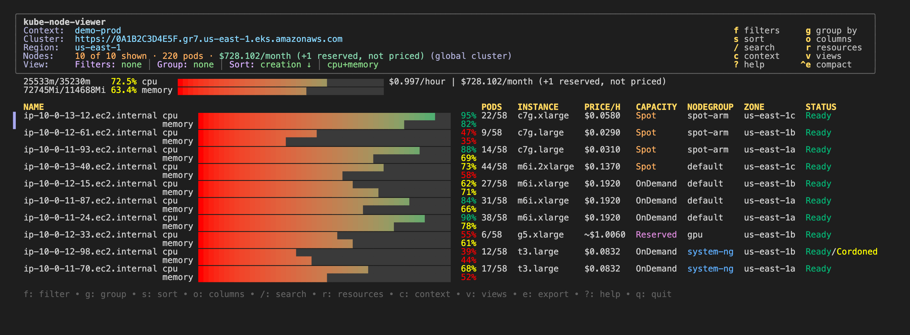

**Header box.** The context, API server URL and pricing region; how many nodes
the filters and search keep out of all watched nodes, with their pod count
(and pending pods, when there are any); the cost of the whole cluster, which
stays put whatever the filters; the active view (filters, group-by,
sort, resources); the main keys. `ctrl+e` switches between this full panel
and a two-line box. On a very short window it shrinks to one line.

**Cluster summary.** Requested over allocatable, the percentage and a bar for
each resource, and the cost per hour and per month, for the nodes on screen:
with filters or a search it covers only the nodes they keep and says so,
`(filtered: 3 of 10 nodes)`.

**Node list.** One block per node: a usage bar per resource (stacked, with a
blank line between nodes when more than one resource is shown), the pods on
the node over its pod capacity, then the columns you picked. Default columns:

| Column | What it shows |
|--------|---------------|
| `INSTANCE` | instance type (`<cpu>vCPU-<mem>GB` for a Fargate pod) |
| `PRICE/H` | hourly price; `~$` marks an on-demand equivalent for a reserved node (see [Pricing](#pricing)); `-` when unknown |
| `PRICE/M` | the hourly price × 730, per month, with the same `~$` and `-` |
| `IDLE/M` | what the node pays per month for capacity nothing requests: price × (1 − the larger of cpu and memory use) × 730; `-` without a real price |
| `CAPACITY` | `OnDemand`, `Spot`, `Reserved`, `Fargate` or `Unknown`, with `/Auto` for EKS Auto Mode |
| `NODEGROUP` | the Karpenter NodePool, or the EKS managed node group or AKS agent pool name in blue |
| `ZONE` | availability zone |
| `STATUS` | `Ready` or `NotReady/<for how long>`, plus `Cordoned`, `Deleting`, `Launching` (a Karpenter NodeClaim whose node has not registered yet) |

The Columns panel (`o`) also offers `IDLE/H` (the idle cost per hour), `IP`,
`REGION`, `AGE`, the computed labels and any node label. Hourly and monthly
columns are separate: show either or both. Sorting by `price` or `idle`
orders both. With `--disable-pricing` no price or idle column is drawn. All
the default columns need about 172 columns of terminal width; on a narrower
window `ZONE`, `NODEGROUP` and `INSTANCE` go first.

**Groups.** With a group-by, nodes nest under up to three levels. Top-level
groups are in bold blue with a blank line between them; sub-groups hang off
them with `├─`/`└─` and show only their own value. Every heading carries node
and pod counts, usage per resource and cost; a cost prefixed with `>=` means
some node in the group has no known price.

**Colours.**

| Colour | Meaning |
|--------|---------|
| green / yellow / red percentage and bar | usage above 80% / 60–80% / below 60%: an under-used node is the costly case |
| green `Ready` · red `NotReady`, `Deleting` · yellow `Cordoned`, `Launching` | node status |
| orange `Spot` · magenta `Reserved` · blue `Fargate` | capacity types that change what a node costs |
| blue node group name | an EKS managed node group or an AKS agent pool; plain is a Karpenter NodePool |

The three usage colours come from `--style`.

**Pages.** When the list is taller than the window it is cut into pages
(`←`/`→`); a page that continues a group repeats its path with `(cont.)`. On
a narrow window the least important columns are dropped first, and the footer
says how many are hidden. Lines never run past the window edge.


With `ctrl+e` the header shrinks to two lines:

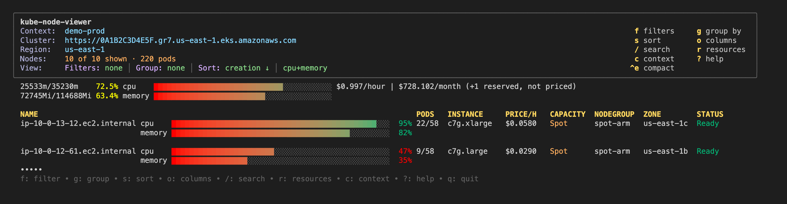

## Keys

| Key | Action |
|-----|--------|
| `f` | Filters panel |
| `g` | Group by panel |
| `s` | Sort panel |
| `I` | Flip the sort between ascending and descending, without opening the Sort panel |
| `o` | Columns panel |
| `/` | Search name, IP, instance type and label values as you type, any case; a regular expression such as `search\|batch` (see [Search](#search-)); `enter` keeps it, `esc` clears it |
| `r` | Resources: cpu → memory → cpu+memory (→ the `--resources` list, if different) |
| `↑`/`↓`, `k`/`j` | Select a group heading or a node; the selected row is marked in the left margin |
| `enter`, `space` | Fold or unfold the selected group on its own (`▸` marks a folded group) |
| `enter` on a node | Its details: instance, price, system, resources, conditions, taints, labels |
| `n` | Fold one level per press when grouping: the nodes, then each sub-group level down to the top level; the next press unfolds all |
| `d` | While folded: list the next group level under each group as one-line rows, or hide them |
| `tab` | Switch between Overview and Recommendations |
| `tab` in node details | Switch between the Details and Pods tabs (see [Node details](#node-details)) |
| `d` in the Pods tab | Switch between all pods and the DaemonSets view (a Total line, then one row per DaemonSet) |
| `:` | Command line: `overview` (`ov`), `recommendations` (`rec`); `tab` completes |
| `c` | Switch to another kubeconfig context |
| `v` | Named views: apply one, save the current view under a name, delete |
| `e` | Export the nodes on screen to CSV and JSON |
| `ctrl+e` | Compact or expand the header |
| `←`/`→`, `h`/`l`, `home` | Previous / next / first page |
| `?` | All keys and colours |
| `q`, `ctrl+c` | Quit |

Panels open as a popup over the node list, with their own keys on their last
line. While a panel or the search is open, keys go to it: `q` or `f` are typed,
not commands, and `esc` closes the panel or steps back. `ctrl+c` and `ctrl+e`
work everywhere. `esc` never quits. In Filters, Group by, Sort and Columns,
`a` shows the labels the config file hides, until the panel closes (see
[Label visibility](#label-visibility)).

### Search (`/`)

The search keeps the nodes whose name, internal IP, instance type or a label
value contains the text, ignoring case. Text with any of
`| ( ) [ ] { } ^ $ * + ? \` is a regular expression
([RE2 syntax](https://github.com/google/re2/wiki/Syntax)), unanchored:

| Search | Keeps |
|--------|-------|
| `batch` | anything containing `batch` |
| `203.0.113.5` | the literal text: `.` alone does not make a regex |
| `search\|batch` | either word (no spaces around `\|`: they would count) |
| `^node-1$` | the value `node-1`, not `node-12` |
| `m7g\.(large\|xl)` | `m7g.large` and `m7g.xlarge`; inside a regex `.` is any character, so write `\.` |

A pattern that does not compile yet (`a(b` while typing) is matched as plain
text; the footer says `invalid regex: as text` and the header shows
`(as text)` after it. `(?-i)` at the start makes it case-sensitive.

## Panels

### Filters (`f`)

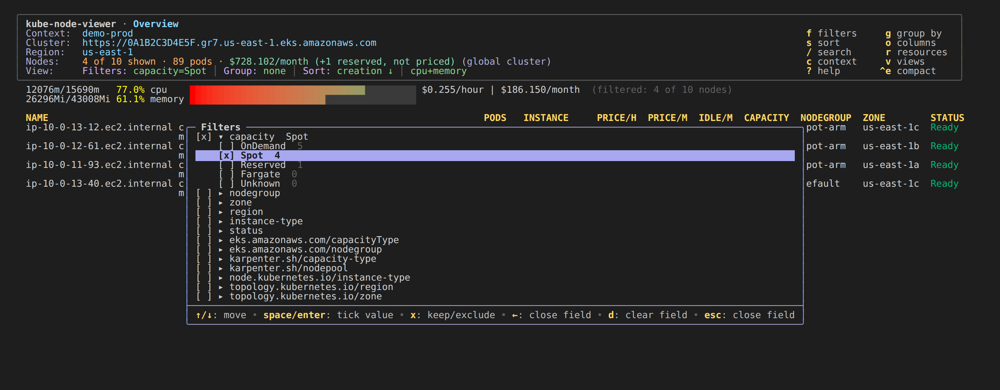

Every field is listed (`capacity`, `nodegroup`, `zone`, `region`,
`instance-type`, `status` and every label found on the nodes), the ones
already filtered first. `enter` (or `→`) opens a field in place and lists its
values with the number of nodes having each; `space` ticks a value and the
list filters at once. On a field row, `space` turns its filter off and on
without losing the values, `x` switches it between keeping and excluding
the ticked values (`capacity≠Spot` keeps every node but Spot ones), and `d`
clears it. `←` or `esc` folds the field.

Values of one field combine with OR, fields with AND: `capacity ∈ {Spot}` and
`zone ∈ {us-east-1a, us-east-1b}` keeps spot nodes in either zone. A status
filter keeps a node that has any of the ticked flags.

### Group by (`g`)

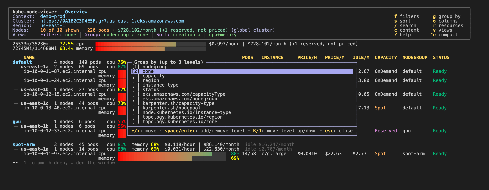

The same list of fields. `space` ticks a field as the next level (the first
ticked is the top level, each next one a sub-group of the previous), up to
three; the rows show `[1]`, `[2]`, `[3]`. `K`/`J` move the level under the
cursor up or down; unticking a level moves the ones below it up. Nodes
without a value for a level go to a `<none>` group, always last.

Folding one group: select its heading with `↑`/`↓` and press `enter`; it
shows `▸` and its contents hide, the other groups stay as they are. Folded
groups are saved with the view.

### Node details

Select a node with `↑`/`↓` and press `enter`: a popup shows what
`kubectl describe node` would, minus events: instance type,
capacity and price per hour and per month, node group, zone, status and age, kubelet and OS,
provider ID, resources as requested / allocatable / capacity (GPUs and other
extended resources included), conditions (bad ones in red), taints and every
label. It follows the live node; `↑`/`↓` scroll, `esc` closes.

CPU is always in millicores (`7516m (95%) / 7910m / 8000m`). When
allocatable equals capacity, the row shows requested / allocatable only.
Pods are not a resource row: after Resources, a Pods section gives the pods
on the node over the most it takes, then a DaemonSets section says what the
node's DaemonSets request together:

```text
Pods  on the node / max
  23 (40%) / 58

DaemonSets  requested (of allocatable)
  6 pods, 5 sets
  cpu     620m (8%)
  memory  1.1Gi (4%)
```

or `none on this node`.

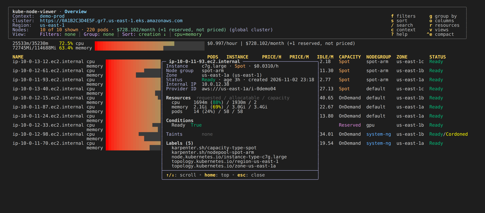

**Pods tab.** `tab` switches the popup between Details and Pods. The Pods
tab lists every pod the node's totals count: namespace/name, CPU request
and its percent of the node's allocatable CPU, memory request and its
percent of allocatable memory, share and hourly cost. Above the rows, a
fixed line shows the instance type, the node price, the pod count and the
requested / allocatable CPU and memory. The tab follows the live node.

```text
 ip-10-0-1-23
 Details  [Pods]   view: all pods                                   sort: cost ↓
 m6i.2xlarge $0.3840/h · 9 pods · cpu 4.12/7.91 52% · mem 13.1/30.1Gi 44%
   POD                                  CPU  CPU%  MEMORY  MEM%  SHARE    COST/H
   search/indexer-0                    1.50   19%   8.0Gi   27%    27%   $0.1021
   payments/api-7f9c-x2kq              2.00   25%   4.0Gi   13%    25%   $0.0971
   logging/fluent-bit-9qzlm ds         0.20    3%   448Mi    1%     3%   $0.0097
   monitoring/node-exporter-4tq8w ds   0.12    2%   128Mi    0%     2%   $0.0058
   kube-system/kube-proxy-p2mvn ds     0.10    1%   128Mi    0%     1%   $0.0049
   kube-system/legacy-agent-c4k9z ds   0.08    1%    64Mi    0%     1%   $0.0039
   kube-system/ebs-csi-node-hx5rd ds   0.07    1%   256Mi    1%     1%   $0.0034
   kube-system/aws-node-x7k2 ds        0.05    1%   128Mi    0%     1%   $0.0024
   batch/report-28911                 no requests
```

The share of a pod is the larger of its CPU and memory percents, and its
cost is that share of the node's hourly price. On a node that costs
$1000/month, a pod with 10% of the CPU and 25% of the memory takes 25% of
the node and costs $250/month. The costs of the pods on a node can add up
to more than the node price: each one says what part of the node that pod
holds. A percent whose allocatable is zero or missing shows `-` and is left
out of the share. An unknown price shows `-`, and a reserved node shows
`~$` as PRICE/H does.

DaemonSet pods are listed with the others, one row per pod, marked `ds`
after the name; a static pod is not marked. `d` switches to the DaemonSets
view and back: a fixed `Total (<n> pods, <m> sets)` line with what every
DaemonSet pod on the node requests together, then one row per DaemonSet
(namespace/name). Pods whose DaemonSet name is not known share one
`<unnamed>` row, which the set count leaves out. The Total's share and cost
come from the summed requests, not from adding the rows: a DaemonSet with
10% of the CPU and another with 20% of the memory make a Total of 20%, not
30%. A node with no DaemonSet pods shows `no DaemonSets`. `enter` and
`space` do nothing in the Pods tab.

```text
 Details  [Pods]   view: daemonsets                          sort: cost ↓
 m6i.2xlarge $0.3840/h · 9 pods · cpu 4.12/7.91 52% · mem 13.1/30.1Gi 44%
   DAEMONSET                   CPU  CPU%  MEMORY  MEM%  SHARE    COST/H
   Total (6 pods, 5 sets)     0.62    8%   1.1Gi    4%     8%   $0.0301
   logging/fluent-bit         0.20    3%   448Mi    1%     3%   $0.0097
   monitoring/node-exporter   0.12    2%   128Mi    0%     2%   $0.0058
   kube-system/kube-proxy     0.10    1%   128Mi    0%     1%   $0.0049
   <unnamed>                  0.08    1%    64Mi    0%     1%   $0.0039
   kube-system/ebs-csi-node   0.07    1%   256Mi    1%     1%   $0.0034
   kube-system/aws-node       0.05    1%   128Mi    0%     1%   $0.0024
```

On the node list, with the cursor on a node, a line above the keys says how
much of that node its DaemonSets request, without a cost:

```text
ip-10-0-1-23 · DaemonSets: 8% of the node (cpu 620m 8% · mem 1.1Gi 4%)
```

or `ip-10-0-1-23 · no DaemonSets`. The share is the larger of the two
percents of the summed DaemonSet requests, as in the Total line, and a
percent shows `-` when its allocatable is missing. The line follows the live
node and is cut with `…` on a narrow window. It is blank on a group heading
and while the search or the command line is open; a panel open over the
list takes its place, and Recommendations does not show it. The node list
is one line shorter to make room for it; on a window too short to keep
three list lines besides it, the line is left out.

`s` cycles the sort through cost, CPU, memory and name, and `S` flips its
direction. The default is cost, biggest first; name starts A to Z. Without
a known price the cost sort orders by share. Ties break on namespace/name.
A pod that requests neither CPU nor memory shows `no requests` and sorts
last whatever the sort; a pod without the sorted request (a memory-only pod
under the CPU sort) sorts after those that have it. With `--disable-pricing` there is no COST/H column
and no price on the node line, and the sort starts at CPU.

`↑`/`↓` move over the rows, `pgup`/`pgdown`/`home` move by ten rows or to
the top, `d` switches the view (the cursor goes to its first row), `tab`
goes back to Details and `esc` closes. On a narrow window
the pod name is cut with `…` first, then the percent columns are dropped,
then CPU and MEMORY; POD, SHARE and COST/H always stay.
The view, the sort and the cursor reset when the popup opens again.

Folding with `n`: the deepest level on screen carries the usage bars and the
levels above it are one-line summaries. With `zone › instance-type`:

| Presses | On screen |
|---------|-----------|
| 0 | zones and instance types as one-line headings, nodes with bars |
| 1 | zones as one-line headings, instance types with bars |
| 2 | zones with bars (`d` adds their instance types as one-line rows) |
| 3 | back to everything |


One press of `n` (zones carry the bars):

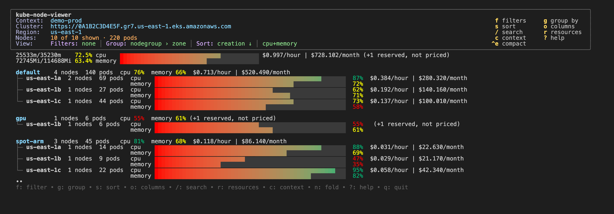

Two presses and `d` (node groups carry the bars, their zones as one-line rows):

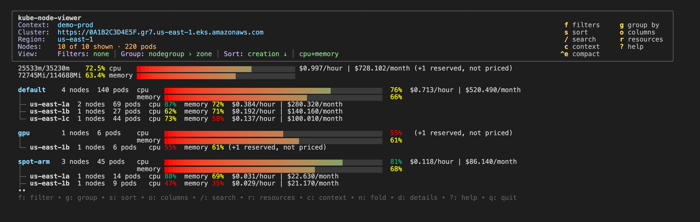

### Sort (`s`)

Creation time, name, IP, price, pods, usage of each resource, any derived
field or label. `enter` sorts by the row under the cursor; on the current
sort it flips the direction, and so does `space`; on the main screen `I`
(shift+i) flips it without opening the panel. Price, pods, usage and
creation start biggest or newest first. Nodes without a value sort last in
either direction; ties break on the node name.

### Columns (`o`)

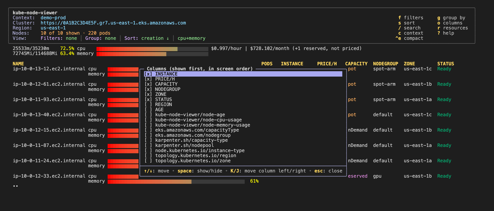

Shown columns first, in screen order, then the others and every label.
`space` shows or hides the column under the cursor (a new one goes at the
end) and `K`/`J` move it left or right.

### Views (`v`)

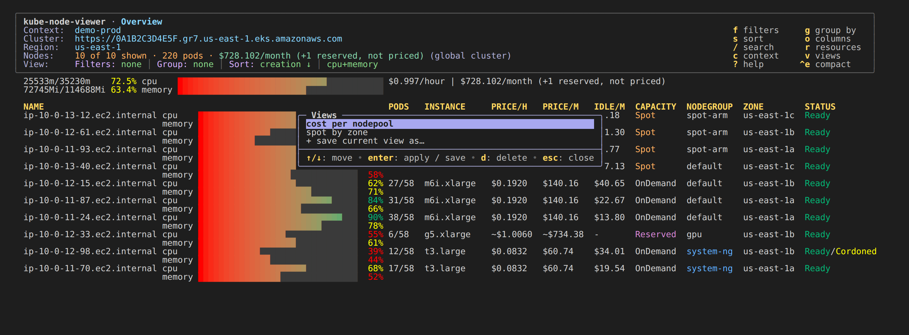

Named views are saved combinations of filters, group-by, folding, sort,
resources and columns, shared by every cluster. `enter` applies one (it
becomes the cluster's view, saved as usual), `d` deletes it, and
`+ save current view as…` asks for a name: type it, `enter` saves, `esc`
cancels. Saving under an existing name replaces it. A named view leaves out
the search text, groups folded one by one and the header size.

Views written in `config.yaml` come first, marked `(config)`; see
[Config views](#config-views). They apply like the others, but `d` and
saving under their name are refused: edit the file instead.

### Export (`e`)

`e` writes every node the filters and search keep (all pages, folded groups
included) to `kube-node-viewer-<context>-<YYYYMMDD-HHMMSS>.csv` and `.json`
in the current directory, or next to the state file when the current
directory is not writable; the footer says where. The CSV has one row per
node: name, group path, instance type, capacity, node group, zone, region,
IP, status, age, pods, requested / allocatable / percent per resource, price
per hour, price kind (`actual`, `equivalent`, `unknown`, `disabled`) and the
label columns you picked. The JSON adds the view (its `search` is the text
as typed, a regular expression when it has regex characters), the totals of
the exported nodes and of the cluster, the context and the time.

### Context (`c`)

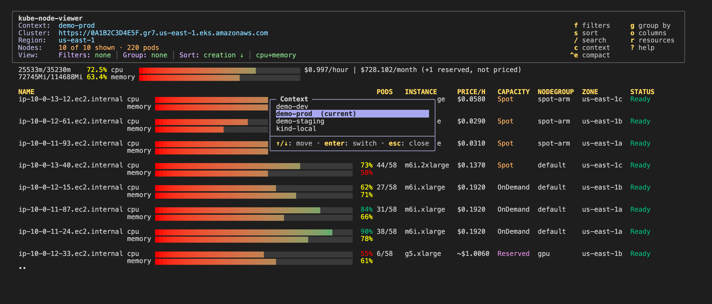

The kubeconfig contexts, the current one marked. Picking another connects to
it without restarting: its watches start, the previous cluster's stop, the
pricing region follows the new cluster, and its saved view comes back.
Nothing from the previous cluster shows after the switch. A connection error
stays in the panel and the current cluster keeps running.

## Recommendations

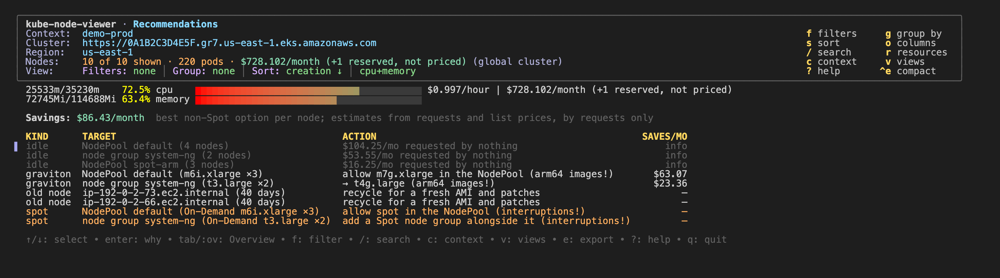

`tab` (or `:rec`) switches to Recommendations; `tab` again (or `:ov`) goes
back to Overview. The filters and search apply: recommendations cover the
nodes on screen. Every row is a fixed rule over requests, allocatable,
prices, labels and node age — no AI, nothing installed in the cluster, no
AWS permission beyond pricing — and `enter` shows its math:

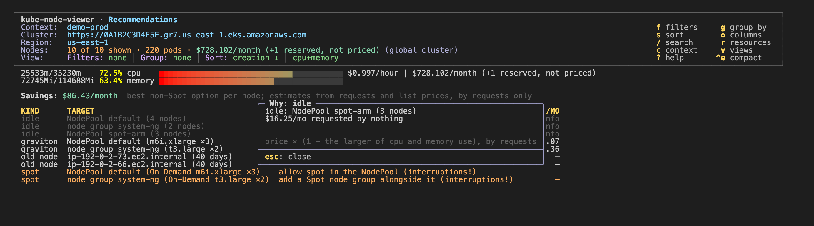

| Kind | Rule |
|------|------|
| `idle` | what each NodePool or node group pays for capacity nothing requests (information) |
| `consolidate` | a managed node group's pods fit on fewer nodes of its type at the headroom (first-fit decreasing; DaemonSet and static pods stay on every node). For a Karpenter NodePool it is information: Karpenter consolidates on its own |
| `rightsize` | a node's requests fit a smaller size of the same family at the headroom |
| `generation` | a previous-generation or Xen family (`t2`, `m4`, `c4`, `r4`, …) has a cheaper current, Nitro counterpart in the same size |
| `graviton` | an x86 family has a cheaper arm64 counterpart in the same size (images must run on arm64) |
| `old node` | a node is older than the age limit: recycle it for a fresh AMI |
| `spot` | an On-Demand group would cost less on Spot, priced in each node's zone; always last, workloads must tolerate interruptions |

The **Savings** line counts each node once, with its best non-Spot saving;
idle, Karpenter consolidation and Spot stay out of it. Savings are estimates
from requests and list prices; affinity, taints, spread constraints,
disruption budgets and volumes are not considered. Nothing is recommended
for Fargate, EKS Auto Mode, nodes of an unknown instance type or nodes on
other clouds; with pods waiting for a node, consolidation and rightsizing
wait.

Settings in `~/.kube-node-viewer`:

```text
# highest share of allocatable a node may reach after a change (default 80)
recommend-headroom=80
# age after which a node is worth recycling (default 30d; 12h, 90m work too)
recommend-node-age=30d
```

Instance sizes come from a catalog generated from the AWS Price List and
embedded in the binary, refreshed at run time from the products the pricing
lookup already reads.

## Saved view per cluster

Filters, group-by, sort, resources, columns, folding depth, details, folded
groups, the screen and the header size are saved per cluster, and named views (`v`) for
all of them, (context name plus API server URL, since
merged kubeconfigs can repeat context names) in
`$XDG_STATE_HOME/kube-node-viewer/state.json`, by default
`~/.local/state/kube-node-viewer/state.json`. Writes are batched and atomic,
so the file survives the tool being killed. The search text is not saved.

At start the view is built from, lowest to highest:

1. built-in defaults;
2. the config file `~/.kube-node-viewer`;
3. the saved view for this cluster, which replaces both, or the start view
   of `config.yaml` (see [Config views](#config-views));
4. flags given on the command line, for this run only: they are saved only
   once you change the view from the TUI.

A corrupt or unreadable state file is ignored with a warning before the TUI
starts. To start a cluster over, delete its entry (or the whole file) while
the tool is not running.

## Flags and config file

```text
Usage of kube-node-viewer:
  -attribution
    	Show the Open Source Attribution
  -context string
    	Name of the kubernetes context to use
  -disable-pricing
    	Disable pricing lookups
  -extra-labels string
    	A comma separated set of extra node labels to display
  -group-by string
    	Node label to summarize usage and cost by, optionally with a filter on a comma separated list of its values, e.g. 'karpenter.sh/nodepool' or 'karpenter.sh/nodepool=default,gpu'. Applies to this run; the last view chosen in the TUI is restored per cluster, unless config.yaml sets default-view with start-with: default-view
  -groups-only
    	Start folded to the --group-by groups, with the node list hidden. At runtime 'n' folds and unfolds one level per press
  -kubeconfig string
    	Absolute path to the kubeconfig file (default "~/.kube/config")
  -labels-allow string
    	Comma separated node label key patterns the panels offer ('*' matches anything), in place of labels.allow in ~/.config/kube-node-viewer/config.yaml for this run; '' offers every label
  -labels-deny string
    	Comma separated node label key patterns the panels leave out, in place of labels.deny in ~/.config/kube-node-viewer/config.yaml for this run; '' denies none
  -node-selector string
    	Node label selector used to filter nodes, if empty all nodes are selected
  -node-sort string
    	Sort order for the nodes, either 'creation' or a label name. The sort order defaults to ascending and can be controlled by appending =asc or =dsc to the value. (default "creation=dsc")
  -resources string
    	List of comma separated resources to monitor (default "cpu")
  -style string
    	Three color to use for styling 'good','ok' and 'bad' values. These are also used in the gradients displayed from bad -> good. (default "#04B575,#FFFF00,#FF0000")
  -v	Display kube-node-viewer version
  -version
    	Display kube-node-viewer version
```

Paths in the help are shown here for the default home directory. The help
of `-labels-allow` and `-labels-deny` names the file the run reads, under
`$XDG_CONFIG_HOME` when that is set to an absolute path.

How the flags map to the view:

| Flag | Effect |
|------|--------|
| `--node-selector` | the only server-side scope: nodes outside it are never watched |
| `--group-by key` | group-by level 1 = the label `key` |
| `--group-by key=a,b` | the same, plus a filter `key ∈ {a, b}` you can turn off in the Filters panel |
| `--groups-only` | start folded to the groups |
| `--node-sort` | the sort (`creation` or a label, `=asc` / `=dsc`) |
| `--extra-labels` | label columns after the default ones |
| `--resources` | the resources; a list other than cpu / memory / both becomes a fourth step of `r` |
| `--context`, `--kubeconfig` | which cluster; view flags apply to the cluster the run starts on |
| `--style`, `--disable-pricing` | run options, not saved |
| `--labels-allow`, `--labels-deny` | the label lists of [`config.yaml`](#label-visibility) for this run; not saved |

`-kubeconfig` also reads `KUBECONFIG` (flag > env var > config file).

Examples:

```shell
# Karpenter nodes only, watched server-side
kube-node-viewer --node-selector karpenter.sh/nodepool
# Start on cpu and memory, grouped by nodepool and folded to the groups
kube-node-viewer --resources cpu,memory --group-by karpenter.sh/nodepool --groups-only
# A few nodepools at once
kube-node-viewer --group-by karpenter.sh/nodepool=default,gpu,spot
# Sort by CPU usage, highest first
kube-node-viewer --node-sort=kube-node-viewer/node-cpu-usage=dsc
# Another cluster, AWS profile for pricing
AWS_PROFILE=myprofile kube-node-viewer --context staging
```

### Config file

`~/.kube-node-viewer` holds standing defaults, one `option-name=value` per
line, option names being the flag names. A saved view for a cluster takes
precedence over it. The label lists are not read from this file; they live
in [`config.yaml`](#label-visibility).

```text
# select only Karpenter managed nodes
node-selector=karpenter.sh/nodepool

# display both CPU and memory
resources=cpu,memory

# group by nodepool, starting folded to the groups
group-by=karpenter.sh/nodepool
groups-only=true

# extra label columns
extra-labels=topology.kubernetes.io/zone

# newest nodes last
node-sort=creation=asc

# change the good / ok / bad colours
style=#2E91D2,#ffff00,#D55E00
```

## Label visibility

Nodes often carry dozens of labels. An allow list and a deny list in
`~/.config/kube-node-viewer/config.yaml` decide which node labels the
Filters, Group by, Sort and Columns panels offer. When `XDG_CONFIG_HOME` is
set to an absolute path, the file is
`$XDG_CONFIG_HOME/kube-node-viewer/config.yaml` instead.

```yaml
labels:
  allow:
    - karpenter.sh/nodepool
    - karpenter.sh/capacity-type
    - topology.kubernetes.io/zone
    - team
    - app.example.com/*
  deny:
    - app.example.com/internal-*
```

Or only hide what you never use:

```yaml
labels:
  deny:
    - "*.amazonaws.com/*"
    - beta.kubernetes.io/*
    - kubernetes.io/hostname
```

The rules:

- A pattern matches the whole label key, case-sensitively. `*` matches any
  run of characters, `/` and `.` included; every other character is itself.
  `karpenter.sh/*` matches `karpenter.sh/nodepool`, `karpenter` does not.
  Quote a pattern that starts with `*`.
- With an allow list, a panel lists only the labels that match one of its
  patterns. Without one (or with `allow: []`), it lists every label.
- Deny wins: a label that matches a deny pattern is left out, even when it
  also matches an allow pattern.
- The derived fields (`capacity`, `nodegroup`, `zone`, `region`,
  `instance-type`, `status`) and the [computed labels](#computed-labels) are
  never hidden.
- A label the view uses (a filter, a group-by level, the sort or a column)
  stays listed and keeps working, so you can change or remove it. Once it is
  out of the view, the panels stop listing it the next time they open.
- The lists only trim the panels. Node details, the `/` search and the
  export still see every label.

When a panel hides labels, a line above its keys says how many:
`38 labels hidden by config • a: show all`. `a` lists them all
(`showing all labels • a: hide`) until the panel closes; the file is not
changed.

`--labels-allow` and `--labels-deny` replace the file's list of the same
name for one run, as comma separated patterns. An empty value means no list:

```shell
kube-node-viewer --labels-allow 'karpenter.sh/*,team'
kube-node-viewer --labels-allow ''
```

A missing file is fine. A file that cannot be read or is not valid stops
the start, before the TUI, with the file and the reason: YAML syntax, an
unknown key, or a list item that is empty or not a string (quote `yes`,
`123` and the like):

```text
$ kube-node-viewer
2026/11/02 21:58:44 config file /home/me/.config/kube-node-viewer/config.yaml: unknown field "lables"
$ echo $?
1
```

## Config views

`config.yaml` can also hold views written by hand: columns, group-by, sort,
resources and filters. One of them can open every cluster
(`default-view`), and `v` switches between them:

```yaml
views:
  - name: cost
    columns:
      - instance-type
      - price/h
      - price/m
      - capacity
      - status
    group-by:
      - nodegroup
    sort: price
    resources:
      - cpu
      - memory
default-view: cost
```

Every key, the field names, recipes, how the start view is chosen and the
errors are in [docs/views.md](docs/views.md).

## Pricing

Prices come from AWS: on-demand and Fargate from the Price List API, spot from
the EC2 spot price history, refreshed periodically, with a static on-demand
table as a fallback until the first lookup answers. On other clouds, run with
`--disable-pricing` or set prices with the override label below.

**AKS.** Azure nodes are priced from the public
[Azure Retail Prices API](https://learn.microsoft.com/rest/api/cost-management/retail-prices/azure-retail-prices)
(pay-as-you-go list prices in USD; Spot and Windows meters where they apply),
with no Azure login or permission. Prices show a second or two after start.
Nodes show their agent pool, capacity and region; AKS clusters
(`*.azmk8s.io`) make no AWS lookup. Reservations and Savings Plans are not
taken into account.

**Region.** For an EKS cluster the pricing region comes from its API server
URL (`https://<id>.gr7.<region>.eks.amazonaws.com`), also after a context
switch. For other servers (a private endpoint behind your own DNS name,
`kubectl proxy`, a self-managed cluster) each AWS node is priced in its own
region: its `topology.kubernetes.io/region` label, or the region of its
zone. Nodes with neither, and nodes outside AWS, use the AWS SDK's
configured region (`AWS_REGION`, `AWS_DEFAULT_REGION` or the profile;
`us-west-2` without one). On the Recommendations screen, on-demand list
prices come from the region with the most nodes and spot prices from the
zone's region. The EKS Auto Mode management fee is always the `us-west-2`
one.

**Reserved capacity.** Nodes on Karpenter reserved capacity or EKS capacity
blocks are prepaid, so their real hourly cost is unknown here. They show the
on-demand price as an equivalent (`~$0.1344`), and cluster and group totals
leave them out and say so: `$12.10/hour (+1 reserved, not priced)`.

**Override label.** A node labeled `kube-node-viewer/instance-price=<price per
hour>` uses that price instead of a lookup, counted as a real price.

**AWS permissions.** Node and pod data comes from the Kubernetes API. AWS is
only called for pricing, which requires:

```json
{
  "Version": "2012-10-17",
  "Statement": [
    {
      "Effect": "Allow",
      "Action": [
        "pricing:GetProducts",
        "ec2:DescribeSpotPriceHistory"
      ],
      "Resource": "*"
    }
  ]
}
```

Neither action supports resource-level scoping, so `Resource` is `*`. With
`--disable-pricing`, no AWS permissions are needed. AKS clusters need none
at all.

## Computed labels

These names work anywhere a label does: columns, sort, group-by, filters,
`--extra-labels`, `--node-sort`, `--group-by`.

- `kube-node-viewer/node-age`: age of the node
- `kube-node-viewer/node-cpu-usage`: CPU requests over allocatable
- `kube-node-viewer/node-memory-usage`: memory requests over allocatable
- `kube-node-viewer/node-pods-usage`: pods over pod capacity
- `kube-node-viewer/node-ephemeral-storage-usage`: ephemeral storage requests over allocatable

## Troubleshooting

**The view is not what I expect on one cluster.** If `config.yaml` sets
`default-view` (and no `start-with: last-view`), every cluster opens with
that view; set
`start-with: last-view` to get each cluster's saved view back (see
[Config views](#config-views)). Otherwise it is that cluster's saved view.
Change it from the TUI, or quit and delete its entry from
`~/.local/state/kube-node-viewer/state.json`.

**A new default column or order does not show.** Columns saved for a cluster
win over the defaults; adjust them with `o` (`space`, `K`/`J`). A cluster
opened before `PRICE/M` and `IDLE/M` existed shows them only once added
there.

**NoCredentialProviders: no valid providers in chain.** Pricing needs AWS
credentials unless you use `--disable-pricing`. Configure them through
`~/.aws/credentials`, `~/.aws/config`, environment variables or another
provider in the
[default credential chain](https://docs.aws.amazon.com/sdk-for-go/v2/developer-guide/configure-gosdk.html).

**`creating client, exec plugin: invalid apiVersion "client.authentication.k8s.io/v1alpha1"`.**
Update the AWS CLI and
[regenerate your kubeconfig](https://docs.aws.amazon.com/cli/latest/reference/eks/update-kubeconfig.html).

**A red `Issue:` line in the header.** The Kubernetes client or pricing
logged an error, such as a lost connection to the API server; the header
shows the latest for two minutes. While the TUI runs, those messages go to
`kube-node-viewer.log` next to the state file (by default
`~/.local/state/kube-node-viewer/kube-node-viewer.log`), not to the screen.

**`could not open a new TTY`.** The TUI needs a real terminal; run it directly,
not through a pipe or a tool without a TTY.

## How it works

- Three informers watch nodes and Karpenter NodeClaims (within
  `--node-selector`) and all pods. Filters, grouping, sorting and search work
  on memory and never restart them; only a context switch does.
- Pods are slimmed at the informer to what the totals need (requests, phase,
  node) and the store keeps running totals per node, so drawing a frame walks
  no pods but those of the node under the cursor (for its DaemonSets line): with 500 nodes a frame takes about 1.7 ms whether the cluster
  has 15,000 or 150,000 pods. For 150,000 pods the model holds about
  155 MiB; with the informer's slimmed pods the heap is about 680 MiB.
- The screen redraws when the cluster or prices change (at most every
  100 ms), plus a 1 s tick for ages and NotReady durations.
- Each context switch builds a new store with its own watches and pricing;
  late events from the previous cluster land in its own store, which is no
  longer shown.

## Development

See [CONTRIBUTING.md](CONTRIBUTING.md) and [AGENTS.md](AGENTS.md). In short:
`scripts/verify.sh` checks formatting, vet, tests (with the race detector) and
specs, `make lint` runs the pinned golangci-lint (CI runs both), and
`scripts/build.sh` builds the binary.

Data compiled into the binary is refreshed by `make prices` (the static
on-demand tables, from Karpenter, no credentials) and `make catalog` (the
instance catalog, from the AWS Price List; needs `pricing:GetProducts`). The
`Refresh price data` workflow runs `make prices` on the 1st of each month and
opens a PR; it has no cloud credentials, so `make catalog` is run by hand.

## Credits

`kube-node-viewer` is based on
[`awslabs/eks-node-viewer`](https://github.com/awslabs/eks-node-viewer),
licensed under the Apache License 2.0, which was originally developed at AWS
for demonstrating consolidation with [Karpenter](https://karpenter.sh/).
Thanks to its authors and contributors, whose code this project starts from.
This project is not affiliated with or endorsed by AWS.

## License

[Apache License 2.0](LICENSE). See [NOTICE](NOTICE) for attribution.
