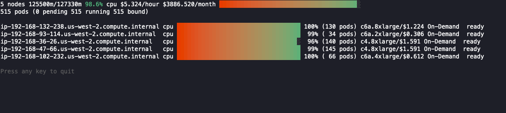

[](LICENSE)
[](https://github.com/StaffOps/kube-node-viewer/actions/workflows/test.yaml)

# kube-node-viewer

`kube-node-viewer` is a terminal UI for watching node usage in a Kubernetes
cluster. It shows the scheduled pod resource requests against each node's
allocatable capacity, plus the node price. It *does not* look at actual pod
resource usage.

Prices come from AWS (on-demand, spot and Fargate). On other clouds, run with
`--disable-pricing`, or set prices per node with the
`kube-node-viewer/instance-price` label.



## Installation

Download a binary from the
[releases](https://github.com/StaffOps/kube-node-viewer/releases) page, or
install with Go:

```shell
go install github.com/staffops/kube-node-viewer/cmd/kube-node-viewer@latest
```

This installs to your `GOBIN` directory, typically `~/go/bin`.

To build from a checkout, run `scripts/build.sh` (binary in
`bin/kube-node-viewer`); `scripts/build.sh -i` installs it and
`scripts/build.sh -a` cross-compiles for every release platform.

## Usage

```text
Usage of kube-node-viewer:
  -attribution
    	Show the Open Source Attribution
  -context string
    	Name of the kubernetes context to use
  -disable-pricing
    	Disable pricing lookups
  -extra-labels string
    	A comma separated set of extra node labels to display
  -group-by string
    	Node label to summarize usage and cost by, optionally restricted to a comma separated list of its values, e.g. 'karpenter.sh/nodepool' or 'karpenter.sh/nodepool=default,gpu'. If empty no summary is displayed
  -groups-only
    	Start with the individual node list hidden, leaving only the --group-by summary. The summary is toggled at runtime with 'g' and the node list with 'n'
  -kubeconfig string
    	Absolute path to the kubeconfig file (default "~/.kube/config")
  -node-selector string
    	Node label selector used to filter nodes, if empty all nodes are selected
  -node-sort string
    	Sort order for the nodes, either 'creation' or a label name. The sort order defaults to ascending and can be controlled by appending =asc or =dsc to the value. (default "creation=dsc")
  -resources string
    	List of comma separated resources to monitor (default "cpu")
  -style string
    	Three color to use for styling 'good','ok' and 'bad' values. These are also used in the gradients displayed from bad -> good. (default "#04B575,#FFFF00,#FF0000")
  -v	Display kube-node-viewer version
  -version
    	Display kube-node-viewer version
```

### Keys

| Key   | Action                                   |
|-------|------------------------------------------|
| `←/→` | Page through whichever list is on screen |
| `g`   | Toggle the `--group-by` summary          |
| `n`   | Toggle the node list                     |
| `q`   | Quit                                     |

`g` and `n` never leave both sections hidden. With a lot of groups the summary
can fill the screen, so hiding one of the two is the way to read the other.

### Examples

```shell
# Standard usage
kube-node-viewer
# Karpenter nodes only
kube-node-viewer --node-selector karpenter.sh/nodepool
# Display both CPU and memory usage
kube-node-viewer --resources cpu,memory
# Display extra labels, i.e. AZ
kube-node-viewer --extra-labels topology.kubernetes.io/zone
# Sort by CPU usage in descending order
kube-node-viewer --node-sort=kube-node-viewer/node-cpu-usage=dsc
# Cost and usage per nodepool, without the per-node detail
kube-node-viewer --group-by karpenter.sh/nodepool --groups-only
# Cost and usage per team, using your own node label
kube-node-viewer --group-by company.com/team
# A few nodepools at once, instead of one terminal per nodepool
kube-node-viewer --group-by karpenter.sh/nodepool=default,gpu,spot
# Specify a particular AWS profile and region for pricing
AWS_PROFILE=myprofile AWS_REGION=us-west-2 kube-node-viewer
```

### Grouping by label

`--group-by` adds a summary block that aggregates every node sharing a value
for the given label. Each group shows its node count, pod count, resource
requests vs allocatable, the percentage in use and the cost, which answers
questions like "how much is this nodepool costing me" or "how much are the
nodes belonging to this team costing me":

```shell
kube-node-viewer --group-by karpenter.sh/nodepool
```

```text
6 nodes  (   98304Mi/377176Mi)  26.1% memory  ██████████░░░░░░░░░░░░  $4.608/hour | $3,363.840/month
48 pods (0 pending 48 running 48 bound)

default  4 nodes  32 pods  (65536Mi/251451Mi)  26.1% memory  ██████████░░░░░░░░░░░░  $3.072/hour | $2,242.560/month
gpu      2 nodes  16 pods  (32768Mi/125725Mi)  26.1% memory  ██████████░░░░░░░░░░░░  $1.536/hour | $1,121.280/month
```

Appending a comma separated list of values restricts the view to them, so a
single flag both picks the nodepools to watch and breaks the cost down by them:

```shell
kube-node-viewer --group-by karpenter.sh/nodepool=default,gpu
```

A few notes:

- The label is any node label, written out in full. Grouping by team, zone,
  instance type or capacity type is the same flag with a different key.
- Values are optional. A bare `--group-by` label only says how to aggregate
  and leaves the node selection alone, which keeps the nodes that don't carry
  the label visible. `--node-selector` is still the flag to use to filter on a
  label other than the one being grouped by.
- The percentage is the usage of the group as a whole, so it is weighted by
  node size rather than being the plain average of each node's percentage. It
  also covers every resource passed to `--resources`.
- Nodes without the label are collected into a `<none>` group, which always
  sorts last.
- A cost prefixed with `>=` means at least one node in the group has an
  unknown price, so the real cost is higher than the number shown. A group
  with no known price at all shows no cost.
- Add `--groups-only` to start with the per-node list hidden. Either section
  can be toggled at runtime: `g` for the summary and `n` for the node list.

### Computed labels

These label names can be passed to `--extra-labels`, `--node-sort` and
`--group-by` to show computed node information:

- `kube-node-viewer/node-age` - age of the node
- `kube-node-viewer/node-cpu-usage` - CPU usage (requests)
- `kube-node-viewer/node-memory-usage` - memory usage (requests)
- `kube-node-viewer/node-pods-usage` - pod usage (requests)
- `kube-node-viewer/node-ephemeral-storage-usage` - ephemeral storage usage (requests)

### Price override label

A node labeled `kube-node-viewer/instance-price=<price per hour>` uses that
price instead of a pricing lookup.

### Default options

You can supply default options in a file named `.kube-node-viewer` in your
home directory. The format is `option-name=value`, where the option names are
the command line flags:

```text
# select only Karpenter managed nodes
node-selector=karpenter.sh/nodepool

# display both CPU and memory
resources=cpu,memory

# show the zone and nodepool name by default
extra-labels=topology.kubernetes.io/zone,karpenter.sh/nodepool

# summarize cost and usage per nodepool, optionally only for some of them
group-by=karpenter.sh/nodepool

# and start with the node list hidden
groups-only=true

# sort so that the newest nodes are first
node-sort=creation=asc

# change default color style
style=#2E91D2,#ffff00,#D55E00
```

### Coming from eks-node-viewer

- If `~/.kube-node-viewer` doesn't exist, `~/.eks-node-viewer` is read instead
  and a warning names the new path. The old file is never changed.
- The `eks-node-viewer/` prefix still works for the price override label and
  the computed label names. When a node carries both price labels,
  `kube-node-viewer/instance-price` wins.

### AWS permissions for pricing

Node and pod data comes from the Kubernetes API through your kubeconfig. AWS
is only called for pricing, which requires:

```json
{
  "Version": "2012-10-17",
  "Statement": [
    {
      "Effect": "Allow",
      "Action": [
        "pricing:GetProducts",
        "ec2:DescribeSpotPriceHistory"
      ],
      "Resource": "*"
    }
  ]
}
```

`pricing:GetProducts` is used for on-demand and Fargate pricing, and
`ec2:DescribeSpotPriceHistory` for spot pricing. Neither action supports
resource-level scoping, so `Resource` is `*`. With `--disable-pricing`, no AWS
permissions are needed.

### Troubleshooting

#### NoCredentialProviders: no valid providers in chain

Pricing needs AWS credentials unless you use `--disable-pricing`. Configure
them through `~/.aws/credentials`, `~/.aws/config`, environment variables or
another provider in the
[default credential chain](https://docs.aws.amazon.com/sdk-for-go/v2/developer-guide/configure-gosdk.html).

#### `creating client, exec plugin: invalid apiVersion "client.authentication.k8s.io/v1alpha1"`

Update the AWS CLI and
[regenerate your kubeconfig](https://docs.aws.amazon.com/cli/latest/reference/eks/update-kubeconfig.html).

## Development

See [CONTRIBUTING.md](CONTRIBUTING.md) and [AGENTS.md](AGENTS.md). In short:
`scripts/verify.sh` checks formatting, vet, tests and specs, and
`scripts/build.sh` builds the binary.

## Credits

`kube-node-viewer` is based on
[`awslabs/eks-node-viewer`](https://github.com/awslabs/eks-node-viewer),
licensed under the Apache License 2.0, which was originally developed at AWS
for demonstrating consolidation with [Karpenter](https://karpenter.sh/). It
was presented in
[Containers from the Couch: Workload Consolidation with Karpenter](https://www.youtube.com/watch?v=BnksdJ3oOEs)
and
[AWS re:Invent 2022 - Kubernetes virtually anywhere, for everyone](https://www.youtube.com/watch?v=OB7IZolZk78).
This project is not affiliated with or endorsed by AWS.

Thanks to:

- the authors and contributors of `eks-node-viewer`, whose code this project
  starts from;
- [João Pedro Alcantara](https://github.com/sule26), for the `--group-by` and
  `--groups-only` features, imported from the `sule26/eks-node-viewer` fork.

## License

[Apache License 2.0](LICENSE). See [NOTICE](NOTICE) for attribution.
